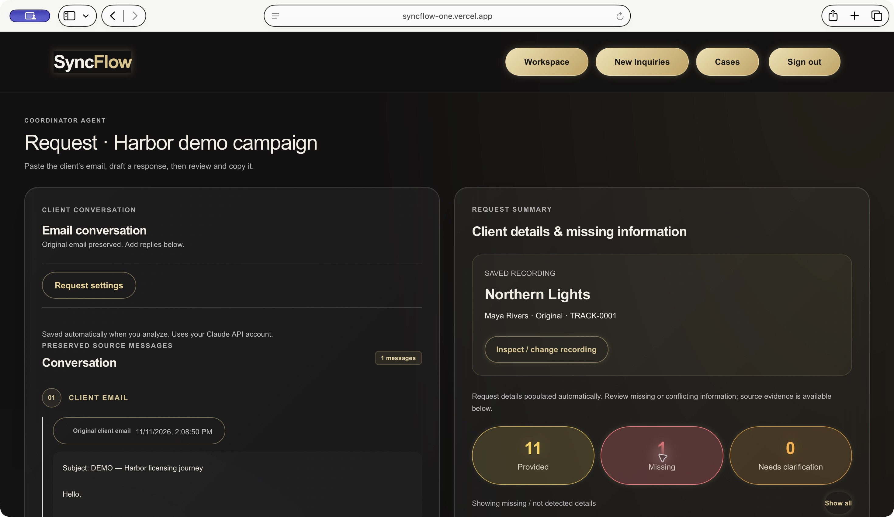

# SyncFlow

Sync licensing coordinators turn client emails into licensing briefs while tracking missing information, changing requirements and response deadlines. Rereading correspondence and reconstructing context for internal reviews takes time and makes important details easier to miss. SyncFlow organizes each case, surfaces the next action and prepares source-backed briefs and follow-up drafts for human review.



*Actual SyncFlow interface captured on November 11, 2026, using a synthetic test case.*

*Built by Ivaylo Nanev and Mosiah James.*

[Open SyncFlow](https://syncflow-one.vercel.app) · [Setup](docs/setup-guide.md) · [Current workflow](docs/user-stories.md) · [Product requirements](docs/prd.md) · [Architecture](docs/architecture.md)

## What It Does

SyncFlow helps sync licensing coordinators turn client correspondence into organized cases and clear next steps.

- **Capture requests:** Paste a client email (or forward it in) and save it as a case with the full correspondence preserved.
- **Focus on urgent work:** See overdue cases first, then today's and upcoming deadlines, each with its blockers and next action.
- **Prepare client follow-ups:** Extract licensing details, flag missing or conflicting information, and draft responses for your review.
- **Handle internal escalations:** Turn saved correspondence into a manager decision request and record the reply.
- **Track cases to completion:** Review history, complete or reopen cases, and recover soft-deleted requests.

## Human control

Agent-extracted details populate automatically and retain their source evidence and agent provenance. They are **not human-confirmed facts**. A current, unblocked correction can change the effective display while preserving the stored human-confirmed record and audit history. Coordinators review exceptions and drafts; automatic extraction is not acceptance or rights clearance.

Drafts are never sent automatically. Copying an email does not mark it sent. Manager decisions and completion are explicit human actions. No agent grants music rights.

## Tech Stack

- **Application:** Next.js 16 App Router, React 19, TypeScript and CSS Modules.
- **AI:** Anthropic Claude Messages API with structured tool outputs for extraction, prioritization and email drafting.
- **Background processing:** Vercel Workflow SDK for durable AI runs and recovery.
- **Database and authentication:** Supabase Postgres and Supabase Auth, integrated through `@supabase/supabase-js` and `@supabase/ssr`.
- **Email intake:** Resend Receiving API and webhooks.
- **Validation and testing:** Ajv for JSON Schema validation, Node.js test runner, Vitest and `@workflow/vitest`.
- **Runtime and deployment:** Node.js 24+, pnpm and Vercel.

**How it fits together:** Resend webhooks deliver incoming emails → Supabase stores each case → Claude extracts details and drafts replies via Vercel Workflow → the coordinator reviews in the Next.js app.

## Repository structure

- `app/` and `components/`: Next.js pages, API routes and shared interface components.
- `agents/` and `workflows/`: AI agent logic and durable background processing.
- `server/` and `lib/`: server operations, integrations and shared utilities.
- `db/`: database schema scripts and persistence documentation.
- `schemas/`, `contracts/` and `types/`: data validation and shared contracts.
- `tests/`, `fixtures/` and `evaluation/`: automated checks, synthetic test data and quality evaluations.
- `docs/`: setup, architecture, product decisions and release evidence.
- `scripts/`: development and verification commands.

## Run locally

Requires Node.js 24+ and pnpm 11.25.0.

```sh
pnpm install --frozen-lockfile
cp -n .env.example .env
pnpm smoke
pnpm dev
```

Preserve existing environment files. Follow the [setup guide](docs/setup-guide.md) for Supabase sign-in, membership, schema scripts, and server-only provider credentials. Local fallback is a development/test harness, not a second production backend.

## Verify

```sh
pnpm test
pnpm test:durable
pnpm lint
pnpm typecheck
pnpm validate:fixtures
pnpm validate:evaluation
pnpm build
```

Tests and mock smoke checks do not call a paid model. A live evaluation requires Claude credentials and may make up to 40 paid calls using synthetic cases only.

## Release evidence and limitations

- [Readiness review and remaining work](docs/readiness-2026-11-11.md)
- [AI usage limits](docs/ai-usage.md) and [durable background runs](docs/durable-ai.md)
- [Evaluation methodology](evaluation/README.md) and [latest Intake verification](docs/intake-reliability-2026-11-11.md) and [earlier full workflow evaluation](docs/evaluation-2026-11-11.md)
- [Clarification routing and quality checks](docs/clarification-quality-2026-11-11.md)
- [Issue triage](docs/issue-triage-2026-11-11.md)

Passing automated tests does not establish human usability, production capacity, or licensing accuracy. Historical evaluation failures remain published; new results are reported separately. Catalog fixtures are synthetic.

## Ownership

Proprietary. All rights reserved. See [LICENSE](LICENSE).

Historical implementation notes live in [docs/history](docs/history/readme-before-readiness-2026-11-11.md).
